<h1 align="center">Hi 👋, I'm Kenneth Ramírez Ugalde</h1>

<h3 align="center">
  Information Systems Engineering Student | Junior Software Developer | Junior Scrum Master
</h3>

  
  
  

---

### 👨‍💻 About Me

I'm an **Information Systems Engineering student at Universidad Nacional de Costa Rica**, with experience in software development, IT support, computer networking, and agile project management.

I have worked as a **Junior Scrum Master and Developer** on a real university software project, combining technical development with Scrum practices and team collaboration.

My background also includes providing technical support, working with institutional information systems, managing databases, and consulting on telecommunications and network certification equipment.

I'm interested in continuously improving my programming skills, learning new technologies, and contributing to real-world software projects.

- 🎓 Studying **Information Systems Engineering** at Universidad Nacional de Costa Rica.
- 💻 Interested in **Software Development, Backend Development, and Database Management**.
- 🚀 Experience working with **Scrum, PHP, Symfony, MySQL, and GitHub Projects**.
- 🌐 Technical background in **Networking, Telecommunications, and IT Support**.
- 🐳 Experience with **Docker, Linux, and development environments**.
- 📚 Continuously learning and exploring new technologies.
- 🌎 Based in **Heredia, Costa Rica**.
- 🗣️ **Spanish (Native) | English (C1 Advanced)**.

---

### 💼 Professional Experience

**🚀 Junior Scrum Master & Developer — SIU Project**

*Universidad San Juan de la Cruz | Mar 2026 – Present*

- Participating in the development of an institutional university management system.
- Supporting the implementation of academic course-offering automation, administrative ticketing, and staff vacation management modules.
- Applying Scrum practices, sprint planning, and agile project coordination.
- Working with Symfony, PHP, MySQL, Doctrine ORM, Twig, Bootstrap, Cypress, and Docker/Lando.
- Managing development activities using GitHub Projects.

**🖥️ Student Assistant — Universidad Nacional de Costa Rica**

*Sep 2024 – 2026*

- Provided technical assistance and troubleshooting for hardware and software.
- Supported administrative and academic staff with institutional processes.
- Digitized, organized, and reviewed institutional documents.
- Assisted with institutional reports, project tracking, and administrative data processing.

**🌐 IT & Computer Networking Technician — Elvatron S.A.**

*Oct 2022 – Dec 2022*

- Provided technical IT support.
- Assisted customers with copper and fiber optic network certification solutions.
- Supported the telecommunications products sales department.
- Trained clients on the use of Fluke Networks certification equipment.

---

### 🛠️ Technical Skills

<h4 align="center">Programming Languages</h4>

  
  
  
  
  
  
  
  
  

<h4 align="center">Frameworks & Development</h4>

  
  
  
  

  
  
  

<h4 align="center">Databases</h4>

  
  
  
  

<h4 align="center">Networking, DevOps & Infrastructure</h4>

  
  
  
  
  

  
  
  

<h4 align="center">Tools & IDEs</h4>

  
  
  
  
  

---

### 📜 Certifications

- 🏅 **Scrum Fundamentals Certified (SFC)** — SCRUMstudy
- 🤖 **Claude Code in Action** — Anthropic
- 🌐 **CCNAv7: Switching, Routing & Wireless Essentials** — Cisco
- 🌐 **CCNAv7: Introduction to Networks** — Cisco
- 🐧 **NDG Linux Unhatched** — Cisco
- 🖥️ **IT Essentials** — Cisco
- 🗣️ **EF SET English Certificate — C1 Advanced (69/100)**

---

### 🚀 Featured Projects

#### 🎮 Courier Quest V2 — AI Opponent

**Python | Artificial Intelligence | Team Project**

A strategy game featuring an AI-controlled opponent capable of making autonomous decisions and competing against human players.

[View Repository](https://github.com/kennethRU/Proyecto2-Courier-Quest-V2)

#### 💊 Prescription & Medication Dispensing System

**Java | Maven | XML | Object-Oriented Programming**

A medical management system designed to handle prescriptions and medication dispensing, using XML for data persistence.

[View Repository](https://github.com/kennethRU/Sistema-de-Prescripcion-y-Despacho-de-Recetas)

#### 📦 Product Reservation System

**C++ | Object-Oriented Programming | UML**

A product reservation application developed using object-oriented design principles and documented with UML diagrams.

[View Repository](https://github.com/kennethRU/sistema-de-apartado)

#### 🎲 Creature Game

**C++ | Object-Oriented Programming | UML**

An RPG-style game featuring a combat system and character attribute management.

[View Repository](https://github.com/kennethRU/Juego-Criatura)

#### 💼 Employment Exchange System

**Java | HTML | CSS | Team Project**

A job placement system designed to manage employment opportunities and application processes for people in computer science.

[View Repository](https://github.com/kennethRU/Proyecto1_BolsaDeEmpleo)

---

### 📊 GitHub Stats

  
  

---

### ⚡ Beyond Technology

Outside of software development, I enjoy:

- 🏀 Basketball
- 🚗 Cars and automotive technology
- 🖥️ Exploring new technologies
- 📚 Learning and developing new skills

---

<h3 align="center">📫 Let's Connect</h3>

  I'm open to internships, junior software development opportunities,
  IT roles, and collaborative technology projects.

  
  

